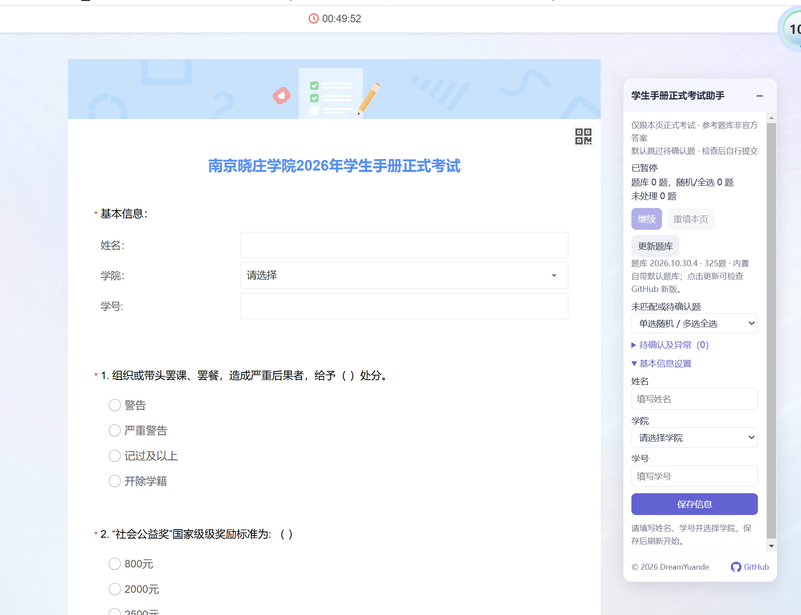

# 南京晓庄学院2026年学生手册正式考试助手

用于南京晓庄学院2026年学生手册正式考试（`YDD4gnE` 页面）的 JavaScript 用户脚本，当前版本 **1.2.3**，使用 MIT License。浮窗标题下方也会显示脚本版本号。

## 已用过油猴：一键安装

如果你已经在**当前浏览器**用 Tampermonkey 正常运行过其他脚本，可以直接安装本脚本，无需重新安装油猴扩展。

1. **[点击一键安装正式版脚本](https://raw.githubusercontent.com/DreamYuande/njxzc-handbook-2026-exam-helper/main/南京晓庄2026学生手册正式考试助手.user.js)** → 在油猴弹出的确认页点击“安装”；已有本脚本时按提示更新。
2. 安装后，[打开正式考试页面](https://ks.wjx.com/vm/YDD4gnE.aspx)；如果页面原本已打开，按 `F5` 刷新。
3. 在右下角助手里填写姓名、学院、学号，先临时保存当前信息，再点击“开始填写”，会保存并自动刷新开始；只想保存时点左侧“临时保存信息”。已保存过完整信息的用户，检查自动读取的内容即可。

“一键安装”链接会打开油猴的安装确认页，仍需你点击确认。若出现新增权限提示，核对脚本名称为“南京晓庄2026学生手册正式考试助手”，题库连接目标为 `raw.githubusercontent.com` 后确认。

只显示代码、只下载了文件或刷新后没有浮窗时，按 [安装教程](安装教程.md) 第 4.2 节手动安装，或第 7 节排查权限。确认填写结果后需自行提交。

## 没有用过油猴：从零安装

**完整顺序：安装油猴扩展 → 开启运行权限 → 安装正式版脚本。**

1. **安装油猴并开启权限：** 按 [从零安装教程](安装教程.md) 的第 1—3 节，完成 Tampermonkey 安装、“允许用户脚本”或对应版本的“开发者模式”设置，以及考试站点访问权限。
2. **安装正式版脚本：** 完成上一步后，[打开正式版脚本安装页](https://raw.githubusercontent.com/DreamYuande/njxzc-handbook-2026-exam-helper/main/南京晓庄2026学生手册正式考试助手.user.js)，核对名称为“南京晓庄2026学生手册正式考试助手”，再点击油猴页面中的“安装”。这个链接用于安装脚本，不会进入考试。
3. **确认安装完成：** 在 Tampermonkey“管理面板”中找到上述正式版脚本，并确认它已启用。只下载了文件、只安装了油猴或只安装了旧模拟版，都还没有完成正式版安装。

如果第 2 步只显示代码或下载文件，按 [安装教程](安装教程.md) 第 4.2 节“手动粘贴安装”完成安装。

## 已安装后使用：打开考试并填写

**确认正式版脚本已安装并启用后，再进行以下步骤。**

1. 在安装脚本的同一个浏览器中，[打开正式考试页面](https://ks.wjx.com/vm/YDD4gnE.aspx)。这个链接进入考试，不负责安装脚本。
2. 等待右下角出现助手浮窗，展开“基本信息设置”，填写姓名、学院、学号。
3. 先点击左侧“临时保存信息”，再点击右侧“开始填写”，脚本会保存信息并自动刷新，先填基本信息，再处理选择题。左侧“临时保存信息”仅保存，不刷新、不开始。
4. 检查填写结果与“待确认及异常”，手动处理需要确认的题目，最后自行提交。

临时保存支持未填完整的信息，重新打开页面会恢复已保存的草稿，直接等待点击“开始填写”；修改任何一项后都需要重新临时保存。开始前会检查姓名、学院和学号，学号必须为 8 位数字；校验不通过不会刷新。

如果没有临时草稿，且已通过旧模拟版在同一浏览器、同一站点保存过完整、有效的基本信息，正式版会读取这些信息；确认后先临时保存，再开始填写。没有出现浮窗时，按 [安装教程](安装教程.md) 第 7 节排查。

更多操作和验证范围见 [正式考试助手使用说明](正式考试助手_使用说明.md)。

## 更新题库（1.1.0 起）

安装时自带默认题库，首次运行与普通刷新不主动联网。助手浮窗会显示当前题库版本、题目数量和来源。

1. 旧版用户先按上方安装步骤更新到 **1.2.2** 并刷新考试页面；油猴如提示新增连接或存储权限，核对后确认。
2. 点击浮窗的 **“检查题库更新”**，脚本暂时停止填写，从本仓库的 [question-bank.json](question-bank.json) 检查新版题库，检查结束后恢复原来的填写状态。
3. 下载并校验通过后，新版题库保存在油猴的本地存储中，下次打开时继续使用；断网或更新失败时保留原有题库。
4. 检查成功后按钮灰显 20 秒，显示“当前已是最新(20)”并倒计时；下一行保留题库版本、题数和来源。未作答题可使用新题库，已完成题及手动调整保留。需要从头填写时，可先临时保存当前信息，再点击“开始填写”保存并刷新。

**更新题库**只读取题目和参考答案；**更新脚本**才会获得新的按钮或程序功能。以后只有题库内容更正时，无需反复重装脚本。题库维护方法见 [题库更新说明](题库更新说明.md)。

## 界面预览



截图为较早版本，按钮以当前脚本为准。图中兜底选项已切换为“单选随机 / 多选全选”；新安装默认仍为“跳过，留待人工检查”。

## 功能

- 支持临时保存姓名、学院、学号；先临时保存当前信息，再点击“开始填写”会保存并自动刷新，先填写基本信息，再按参考题库作答。
- 按题干、题型及完整选项文本匹配，支持选项顺序变化，不依赖页面题号和内部 topic 编号。
- 未匹配、答案待确认或选项不一致时默认跳过；可选“单选随机 / 多选全选”兜底，浮窗列出待确认及异常。
- 支持拖动与折叠；浮窗支持较小屏幕下展开设置与滚动，使用浅色细滚动条，版权页脚固定在底部。
- 自带默认题库，支持按钮从 GitHub 更新并保存；浮窗底部含版权信息和可点击的 GitHub 猫图标。
- 只匹配指定正式考试链接，并在运行时再次核对地址。
- 不自动翻页、提交或处理验证码。检查后需自行提交。

## 数据、题库及验证

只有点击“检查题库更新”时，脚本才会向固定的 `raw.githubusercontent.com` 题库地址发起 GET 请求，不在请求中携带姓名、学号或作答内容，也不发送 Cookie。姓名、学院、学号保存在 `ks.wjx.com` 的 localStorage，键为 `njxzc.handbook.profile.v1`；与旧模拟版共用。已保存完整信息的用户，打开正式版页面会读取已保存信息，仍需先临时保存再开始填写。正式版兜底设置单独保存，下载题库保存在油猴存储中。

题库为参考答案，仍有部分待确认项。当前题库版本、题目数量和来源以助手浮窗显示为准。页面抽题序号和选项顺序会变化，匹配使用题干和选项文本。题库命中与随机／全选均不能视为整套答案已得到官方确认。

已完成语法检查、题库选项乱序匹配及待确认题跳过检查。页面控件副本上的填写、暂停、重填及手机尺寸浮窗检查通过。**电脑版已在真实考试页面验证通过；手机版目前仅完成本地页面副本的布局检查。** 详细验证情况见 [使用说明](正式考试助手_使用说明.md)。

本地语法检查：

```sh
node --check "南京晓庄2026学生手册正式考试助手.user.js"
node --test tests/*.test.cjs
```

题库更新、缓存、格式校验、缺题拒绝、保存失败保留原题库、请求超时与错误响应测试通过；临时保存、开始后自动刷新填写、更新按钮倒计时及缓存重新加载已在本地页面副本中验证。

## 来源与旧项目

本项目基于 [旧模拟版仓库](https://github.com/DreamYuande/njxzc-handbook-2026-mock-exam-helper) 的 1.2.2 版本开发，来源提交为 `659cbeb342e91e79b15aacf7c5468369e4d5c19f`，保留原 MIT License。

旧模拟版与本项目分别适配不同的考试链接。安装过模拟版的用户，需要另外安装本项目的正式版脚本。旧版资料及历史版本可在原仓库查阅，后续正式版说明与更新以本仓库为入口。

## 许可证

[MIT License](LICENSE)。GitHub 猫图标来自 [Primer Octicons](https://github.com/primer/octicons)，其 MIT 许可见 [licenses/octicons-LICENSE](licenses/octicons-LICENSE)。
